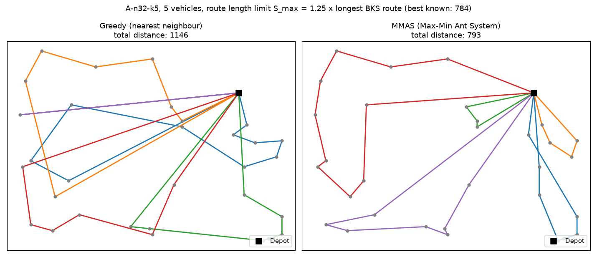
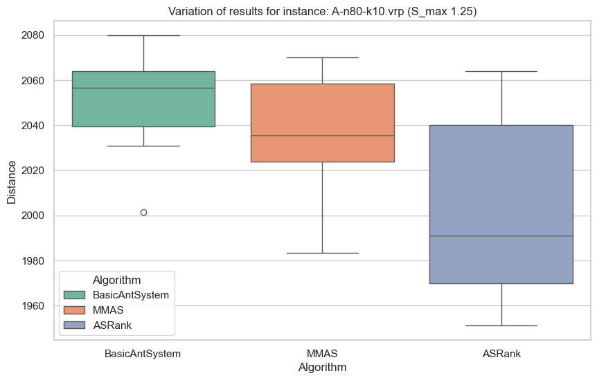
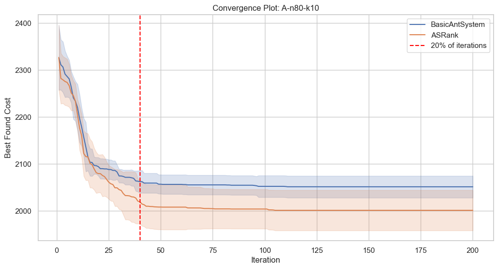

# Ant Colony Optimization for the Distance-Constrained CVRP

Three Ant Colony Optimization (ACO) variants for the Capacitated Vehicle Routing Problem with a limit on route length, written from scratch in Python with NumPy and compared with a greedy baseline on the classic Augerat set A benchmark instances.



## The problem

A fleet of `k` vehicles with capacity `Q` starts and ends at a depot and has to serve every customer exactly once. Each customer has a demand, and a vehicle's load can't exceed `Q`. On top of the classic CVRP, every route has a maximum length `S_max`, so a vehicle can't take on a far-away customer if it couldn't make it back to the depot in time. The goal is the shortest total distance.

`S_max` is set per instance relative to the best known solution (BKS): `S_max = multiplier × length of the longest BKS route`. The experiments use multipliers 1.25 and 1.20, and no limit (`inf`) as a reference.

## Algorithms

| Algorithm | File | How it works |
|---|---|---|
| Greedy (nearest neighbour) | `src/algorithms/greedy.py` | Each vehicle repeatedly goes to the nearest customer that still fits its capacity and the route-length limit. A baseline. |
| Ant System (AS) | `src/algorithms/ant_system.py` | Every ant deposits pheromone on its solution, proportional to `1 / distance`. |
| Max-Min Ant System (MMAS) | `src/algorithms/mmas.py` | Only the iteration's best ant deposits pheromone, and pheromone levels are kept within `[τ_min, τ_max]` to avoid premature convergence. |
| Rank-based Ant System (AS-rank) | `src/algorithms/as_rank.py` | The best-so-far solution deposits pheromone with weight `w - 1`, and the iteration's best `w - 1` ants with weights decreasing by rank (`w = 6`). |

All ACO variants share `src/algorithms/aco_base.py` (the iteration loop and evaporation) and `src/algorithms/ant.py` (solution construction). An ant builds routes one vehicle at a time and picks the next customer with probability proportional to `τ^α · η^β`, where `η = 1 / distance`, among customers that keep the route within capacity and `S_max`. It may also return to the depot early. A solution that leaves customers unserved after all `k` vehicles is infeasible.

Parameters: 200 iterations, as many ants as nodes, `α = 1`, `β = 4`, `ρ = 0.5`.

## Experiments

11 instances from set A (32-80 nodes, 5-10 vehicles), 10 seeds per algorithm and instance, about 23 s per ACO run.

### Results (S_max = 1.25)

Mean gap to the best known solution, over the instances where every method found a feasible solution:

| Method | Gap to BKS | Shorter than Greedy by |
|---|---:|---:|
| Greedy | 39.9% | - |
| Ant System | 17.8% | 15.5% |
| AS-rank | 16.4% | 16.6% |
| **MMAS** | **11.4%** | **20.1%** |



### Hypotheses

| | Hypothesis | Result |
|---|---|---|
| H1 | Every ACO variant is on average at least 15% shorter than Greedy on at least 90% of the instances. | **Rejected.** MMAS on 78% of the instances, AS-rank on 44%, AS on 33%. |
| H2 | MMAS has the lowest standard deviation over the seeds on at least 80% of the instances. | **Confirmed.** MMAS was the most stable on 8 of 10 instances, with a 45% lower standard deviation on average. |
| H3 | After 20% of the iterations, AS-rank's gap to the BKS is at most 95% of the Ant System's. | **Rejected.** It holds on 50% of the instances; on average AS-rank's gap is 8% smaller. |
| H4 | Tightening `S_max` from 1.25 to 1.20 widens the ACO advantage over Greedy by at least 5 percentage points. | **Rejected.** The advantage shrank slightly, by 0.8-1.5 percentage points. |



On A-n39-k5 none of the ACO variants found a feasible solution with 5 vehicles in any run, and on A-n39-k5 and A-n55-k9 Greedy left customers unserved under the route-length limit. These runs are stored as missing values and left out of the comparisons above.

## Getting started

Requires Python 3.12 or newer.

```bash
python -m venv .venv
source .venv/bin/activate        # Windows: .venv\Scripts\activate
pip install -r requirements.txt
```

### Quick demo

Solve one instance with Greedy and an ACO variant, print the distances and plot the routes (a few seconds):

```bash
python main.py demo                                   # A-n32-k5 with MMAS
python main.py demo --instance A-n80-k10 --algorithm ASRank --save routes.png
```

```
Instance A-n32-k5: 32 nodes, 5 vehicles, S_max = 336.2
  Best known solution: 784.0
  Greedy          1146.4 (gap 46.2%), 0.0 s
  MMAS            793.0 (gap 1.1%), 5.6 s
```

### Running the experiments

```bash
python main.py quality --smax 1.25       # H1, H2, H4: Greedy and every ACO variant, 10 seeds -> results/solution_quality_test_smax_1.25.csv
python main.py quality --smax 1.2
python main.py quality --smax inf
python main.py convergence --smax 1.25   # H3: best cost after every iteration of AS and AS-rank -> results/h3/
```

A full quality run takes a couple of hours. The results of all runs are already in `results/`; `src/results_analysis.ipynb` reads them, verifies the hypotheses and draws the plots.

### Tests

```bash
pytest
```

The tests check that Greedy and every ACO variant return feasible solutions (every customer served exactly once, capacity and route length respected, at most `k` vehicles), that the reported distance matches the real length of the routes, and that a run without a feasible solution is reported as such.

### Data

`data/` holds the 11 instances from set A by Augerat et al. (`.vrp`) with their best known solutions (`.sol`), as published in [CVRPLIB](http://vrp.galgos.inf.puc-rio.br/index.php/en/).

## Project structure

```
main.py                     command line: demo, quality and convergence tests
src/
  algorithms/               Greedy, Ant System, MMAS, AS-rank and the shared ant and ACO loop
  parser.py                 reads .vrp instances and .sol solutions
  models.py                 instance and solution data classes
  utils.py                  distances, S_max from the BKS
  experiments_runner.py     solution quality and convergence tests
  visualization.py          route plots
  results_analysis.ipynb    hypothesis verification and plots
results/                    raw results of all runs (CSV)
tests/                      feasibility tests of the solvers
data/                       benchmark instances and best known solutions
```

## License

[MIT](LICENSE)
